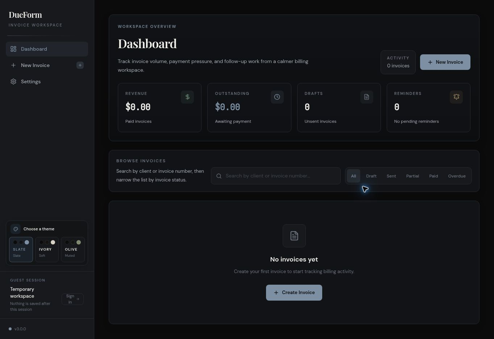

# DueForm

An invoice workspace for freelancers, studios, and small teams. Create invoices, export PDFs, track balances, and reuse client details for repeat billing.

[Try DueForm](https://dueform.vercel.app/) — choose **Continue as guest** to explore without an account.



## Highlights

- Create branded invoices with sender details, client details, tax, due dates, currencies, and optional logo upload
- Save clients and reusable services for faster invoice creation
- Duplicate invoices and automatically mark overdue invoices
- Track partial payments, balances, and payment history
- Support multiple payment methods including bank transfer, PayPal, and crypto
- Send invoices and reminders with Resend
- Share public invoice links for mobile-friendly viewing
- Use guest mode locally or sign in for cloud sync with Supabase
- Switch between three interface themes

## Stack

- Next.js 16
- React 19
- TypeScript
- Tailwind CSS 4
- Supabase for auth and cloud sync
- Resend for email delivery
- jsPDF and html2canvas-pro for PDF export

## Running Locally

1. Install dependencies:

```bash
npm install
```

2. Copy the example environment file and fill in your values:

```bash
cp .env.example .env.local
```

3. Start the development server:

```bash
npm run dev
```

4. Open [http://localhost:3000](http://localhost:3000).

## Environment Variables

Add these values to `.env.local`:

```env
RESEND_API_KEY=
INVOICE_FROM_EMAIL=
NEXT_PUBLIC_SUPABASE_URL=
NEXT_PUBLIC_SUPABASE_ANON_KEY=
APP_URL=http://localhost:3000
```

Notes:

- `RESEND_API_KEY` is required for live invoice and reminder sending.
- `INVOICE_FROM_EMAIL` must be a verified sender Resend allows. Browser-supplied sender addresses are never used.
- `APP_URL` is the canonical public app origin (HTTPS in production), used for email links.
- `NEXT_PUBLIC_SUPABASE_URL` and `NEXT_PUBLIC_SUPABASE_ANON_KEY` enable multi-user auth and cloud sync.
- If Supabase is not configured, the app still works in guest mode with browser storage only.

## Supabase Setup

Apply the SQL in [`supabase/schema.sql`](./supabase/schema.sql) to your Supabase project before using:

- cloud workspace sync
- public invoice links
- multi-user account storage

The app expects email auth to be enabled in Supabase.

## Email Delivery

DueForm uses Resend through:

- `src/app/api/send-invoice/route.ts`
- `src/app/api/send-reminder/route.ts`

Email requires a signed-in, email-verified Supabase account and a saved cloud invoice owned by that account. The server loads the stored invoice and client email rather than trusting invoice or recipient data from the browser. Replies go to the authenticated account email; the configured verified Resend sender is always used.

Both routes share a database-backed limit of 10 attempts per account per hour and one attempt per invoice per minute. Failed provider attempts also consume a slot. Missing quota migration fails closed. These limits reduce abuse but do not replace provider-wide quotas or signup abuse monitoring.

Guest mode still supports local invoicing, payment tracking, CSV and PDF export. Sending and public sharing require cloud sign-in.

## Scripts

```bash
npm run dev
npm run lint
npm test
npm run typecheck
npm run build
npm run start
```

## Deploying

DueForm deploys cleanly on Vercel.

Before deploying, make sure the Vercel project has the same environment variables listed above. For production multi-user access, also make sure your Supabase project has the schema from `supabase/schema.sql`.

## Project Structure

```text
src/app              App routes
src/components       UI components and workspace shell
src/lib              Data model, storage, themes, helpers, cloud sync
supabase/schema.sql  Required database schema for cloud features
```


## Security upgrade for existing projects

Review [the migration and rollout checklist](supabase/SECURITY-MIGRATION.md) before
releasing these changes. Apply the migration before the app update, configure
`APP_URL`, and republish legacy invoice links. No migration or live email is run
by the tests. Run `npm test`, `npm run lint`, `npm run typecheck` and `npm run build`.
